# Sasmita

## Technical Architecture Document (TAD)

### Local-First, Provider-Agnostic AI Workspace

| Field | Value |
|---|---|
| Document status | Locked architecture baseline; Phase 0 spike plan ready |
| Version | 0.3.0 |
| Date | 26 November 2026 |
| Target platform | macOS first, with a path to Windows and Linux |
| Product name | Sasmita |
| Primary stack | MyGo + Svelte 5 + TypeScript + Go |
| Agent orchestration | Eino ADK (loop, interrupt/resume) behind `AgentEngine`; app-owned model adapters |
| Persistence | SQLite + filesystem artifact store |
| Integration protocol | App-owned model adapters (Anthropic-compatible, OpenAI-compatible) + MCP |
| Companion documents | `GLOSSARY.md`, `PRODUCT.md`, `DESIGN.md`, `docs/adr/0001`–`0005`, `docs/spike-plan.md`, `research/` |

### Product identity

- **Product:** Sasmita
- **Category:** Local-first, provider-agnostic AI workspace
- **Brand concept:** Inspired by the idea of a sign, signal, or expression of intent. Sasmita helps turn user intent into useful work through conversation, tools, agents, and visual artifacts.
- **Naming status:** Working product name. Trademark, domain, repository, package, and reverse-domain application identifier availability must be checked before public release.

> This document is a design baseline, not evidence that every component has already been benchmarked. Every decision below is locked for Phase 0, but MyGo, Eino, and the sandboxes must pass the measurable gates in `docs/spike-plan.md` before their interfaces are treated as permanent. Each gate has a pre-decided fallback.
>
> **Terminology:** v0.3 uses the glossary terms. *Mode* replaces "harness profile" (Mode Chat, Riset, Analis Data, Penulisan, Coding). *UI block* (Tier 1) and *sandboxed artifact* (Tier 2) are the two visual output kinds. *Context note* and *compaction* are defined in `GLOSSARY.md`.

## 1. Executive summary

Sasmita is a desktop application that combines the conversational experience of ChatGPT and Claude with the task execution, tool use, project awareness, and artifact generation associated with coding-agent applications. It is provider agnostic and local first: the application, sessions, tools, configuration, and artifacts live on the user's computer by default. Cloud model use is an explicit provider choice, not an assumption that all data should be uploaded.

The product is intended for technical and non-technical users. Its brand concept is inspired by the idea of a sign, signal, or expression of intent: Sasmita should understand what the user is trying to accomplish and help turn that intent into useful work. A user should be able to ask for an Excel analysis, research brief, document, presentation outline, or file organization without understanding MCP, shell commands, provider APIs, or agent harness internals. Advanced users can configure providers, MCP servers, skills, tool permissions, model policies, and custom harnesses.

The main design constraint is to support many capabilities without making the application or every model request unnecessarily heavy. The architecture therefore uses a **modular monolith** for the trusted desktop control plane, lazy capability activation, explicit tool permissions, a small active context assembled per model call, durable session state outside the prompt, and isolated workers for risky execution. It avoids a microservice fleet and does not require a local model server or VM to run all the time.

### Core architecture decisions

1. **Desktop shell:** MyGo (v0.10.x, pinned), with a Svelte 5 + TypeScript frontend in the OS WebView and typed Go-to-TypeScript IPC. Wails v3 is the named fallback if MyGo fails a fundamental gate.
2. **Core/runtime:** Go. Keep application services in one process unless a capability needs isolation or its own lifecycle.
3. **Agent orchestration:** Eino ADK for the agent loop, streaming events, cancellation, and interrupt/resume, wrapped by an application-owned `AgentEngine`. Eino's model components are not used (ADR-0002).
4. **Provider abstraction:** app-owned adapters for **Anthropic-compatible** and **OpenAI-compatible** APIs (configurable base URL), implementing Eino's `ToolCallingChatModel`. The adapters own serialization so the request prefix stays byte-stable.
5. **MCP:** official Go MCP SDK behind `ToolRegistry` and `MCPManager`. MCP Apps deferred (SDK has no support yet).
6. **Persistence:** SQLite (modernc) for metadata, messages, events, checkpoints, approvals, and usage including cache counters; filesystem for attachments and artifacts. FTS first; vectors only when justified.
7. **Context and caching:** append-only request layout `[frozen tools][static system][byte-identical history][new user turn + context note]`; threshold compaction at ~75% of the input budget; tool discovery through fixed meta-tools so the tool list never changes mid-conversation (ADR-0001, ADR-0003).
8. **Security:** permission broker, approval workflow bound to exact arguments, secrets outside prompts, restricted workspace by default.
9. **Visual answers:** concept and process explanations are visual-first. Tier 1 *UI blocks* are declarative specs rendered by Sasmita components. Tier 2 *sandboxed artifacts* are model-written HTML/React run in a sandboxed `artifact://` iframe with no network and no IPC (ADR-0004). Model-generated code never runs in the trusted surface.
10. **Code execution:** three runtimes that never call each other: QuickJS-WASM for `run_script` (Code Mode, later), Pyodide in a hidden `Untrusted` window for data analysis, and a Seatbelt-sandboxed host shell only in Mode Coding. No unsandboxed shell (ADR-0005).
11. **Frontend design:** category-standard chat app, executed precisely, dark by default, bilingual ID/EN (`DESIGN.md`).

## 2. Product goals and non-goals

### 2.1 Goals

- Provide a fast, desktop-native-feeling chat application with streaming responses and persistent history.
- Allow switching between cloud and local model providers without changing conversation or tool interfaces.
- Support built-in tools, MCP servers, skills, workspaces, and configurable harness profiles.
- Make long-running tasks observable, cancellable, resumable, and auditable.
- Generate substantial output by writing sections to persistent artifacts instead of retaining every generated token in the active prompt.
- Minimize idle CPU, resident processes, background activity, and repeated prompt tokens.
- Make safe defaults useful for non-IT users while retaining advanced controls for developers.
- Keep the core interfaces replaceable so the desktop shell, model framework, or orchestration engine can change later.
- Render agent-created charts, diagrams, tables, interactive explainers, and simulations directly inside the conversation.
- Let users manipulate safe visualization controls (for example sliders, segmented controls, and toggles) without requiring a new model inference for every local interaction.

### 2.2 Non-goals for the MVP

- Building or training a foundation model.
- Bundling a large local inference model in the desktop installer.
- Automatically executing arbitrary shell scripts without approval or isolation.
- Launching a multi-agent swarm for every request.
- Shipping a cloud-hosted account, team sync, or remote control plane in the first version.
- Replicating every provider-specific feature through a lowest-common-denominator API.
- Replacing a full IDE or general-purpose office suite.
- Guaranteeing that every model supports vision, audio, tool calling, structured output, or large output budgets.
- Executing model-generated HTML, JavaScript, CSS, or WebAssembly inside the trusted Sasmita application UI. (Model-generated code may run only inside a sandboxed artifact iframe or an isolated worker; see §12A.3 and §15.)
- Treating every response as a visualization. Simple answers stay text; explanations of concepts and processes are visual-first (§12A.8).
- AI-powered artifacts (artifacts that call a model) in v1.
- Running a shell outside an OS sandbox.

## 3. Architecture principles

### 3.1 Local first, not local only

Application settings, conversation history, run events, artifacts, approval records, and MCP configuration are stored locally. Model inference may be local or remote. The UI must disclose when a request sends data to a remote provider and must not silently upload workspace files.

### 3.2 Modular monolith for the trusted control plane

Use packages with explicit interfaces rather than separate always-running services. Introduce another process only when required for security isolation, local inference, or a third-party CLI harness. This reduces deployment complexity and idle overhead.

### 3.3 Capabilities, not provider assumptions

Model and provider selection is separate from agent tools. The application queries a capability profile per model and adapts UI/runtime behavior accordingly. A provider-neutral API must still preserve provider-specific features when they matter.

### 3.4 Context is a view, not the source of truth

The view is also a cache key. Requests are append-only so the provider prefix cache keeps hitting; relevance is managed by what is appended, not by re-selecting history each step (ADR-0001).


SQLite and artifact storage are the durable source of truth. The prompt sent to a model is a limited working view selected for the current task. Do not use the model context as the only copy of task state.

### 3.5 Tools are privileged operations

A model-generated tool call is a proposal, not authorization. All tool calls pass through validation, policy evaluation, and approval/isolation checks before execution.

### 3.6 Observable and resumable runs

A run has a durable ID, state transitions, event history, cancellation, checkpointing, and a clear terminal status. UI state can be reconstructed from persisted events after restart.

### 3.7 Optimize only with measurements

Set baseline budgets and measure aggregate app/WebView memory, startup, UI responsiveness, SQLite behavior, and context tokens on the target Mac. Avoid claiming that a framework choice is inherently lean without an app-level benchmark.

### 3.8 UI is data, not executable model output

The trusted chat renderer consumes only declarative UI specs (Tier 1). The model may propose components, bindings, data, and approved interactions, but it cannot inject executable code into the trusted origin, access the host DOM, call desktop APIs, or bypass the policy engine. When a new interactive explanation needs code, it is a Tier 2 sandboxed artifact: served from `artifact://`, rendered in an iframe with `sandbox="allow-scripts"` only, and given a minimal postMessage bridge. Unknown component types and invalid specs fail closed to text.

### 3.9 Local interaction should not require model inference

A slider, tab, filter, or simulation control should update the visualization locally when the operation can be expressed through an approved deterministic state transition. Only actions that require new reasoning, external data, or privileged tools should return to the agent runtime.

### 3.10 Data volume stays outside the prompt and UI specification

Large datasets, binary payloads, and full-resolution series are stored as artifacts or queried through bounded data services. The model and UI specification receive summaries, schema metadata, and opaque references rather than repeated raw data.

## 4. Users and primary workflows

### 4.1 Personas

- **Everyday user:** asks questions, summarizes files, drafts documents, and expects simple controls.
- **Knowledge worker:** manages projects, reports, long-form generation, research notes, and artifacts.
- **Analyst:** processes Excel/CSV/SQL, runs calculations, validates results, and creates charts/reports.
- **Developer/power user:** configures models, MCP servers, skills, command permissions, and custom harnesses.
- **Privacy-conscious user:** prefers local inference, local persistence, and explicit disclosure before remote data transfer.

### 4.2 Key workflows

1. **Chat:** select model, ask a question, stream the response, save history.
2. **Analyze a file:** select a workspace/file, inspect metadata, process data using a constrained tool, and return findings plus an artifact reference.
3. **Long document:** plan sections, generate them separately, persist each section, validate consistency, and compile a DOCX/Markdown/PDF artifact.
4. **Research:** retrieve sources, record citations and evidence, summarize findings, and create a report.
5. **MCP-assisted task:** discover relevant tool, request permissions where required, execute, persist result, and continue the model loop.
6. **Long-running task:** show progress, allow cancel/pause, persist checkpoint, and resume after app restart.
7. **Provider switch:** choose another model while preserving conversation data, with capability warnings if needed.
8. **Visual explanation:** ask for a difficult concept to be explained graphically; the agent creates an inline diagram, chart, heatmap, comparison, or interactive simulation with controls and supporting metrics.
9. **Interactive exploration:** adjust parameters in an inline visualization, inspect the changed result immediately, and optionally ask the agent to explain or export the resulting state.

## 5. Selected stack and decision record

> The ADRs in this section are the v0.2 records, amended. New decisions live in `docs/adr/`: 0001 append-only request layout, 0002 app-owned model adapters, 0003 hybrid tool discovery, 0004 sandboxed artifacts in a same-process iframe, 0005 separate execution runtimes.

### ADR-001: MyGo as the desktop shell

**Decision:** Use MyGo with a web frontend for the primary product UI. Use Svelte 5 + TypeScript compiled to static assets. Go services are exposed through typed MyGo IPC.

**Why:** This keeps the core in Go, avoids bundling a separate Node.js runtime solely for the application backend, uses the OS WebView instead of a separately bundled browser, and keeps the frontend flexible enough for a rich chat/artifact interface.

**Trade-offs:** MyGo is a fast-moving framework. Its public release line is still 0.x in the repository reviewed for this document. Pin a tested version, hide MyGo calls behind a small `desktop` package, and prove the required IPC streaming, window lifecycle, file dialogs, tray/menu, permissions, and packaging before committing to product-wide use.

**Facts (26 Nov 2026):** MyGo v0.10.0 (released 17 Nov 2026, repo created 26 Sep 2026, requires Go 1.27.3+). The bridge is injected into the main frame only and messages from subframes are dropped, which makes sandboxed artifact iframes feasible. MyGo has no CSP API but custom scheme handlers can set headers. `PageOptions.Untrusted` applies per window, not per iframe. **Fallback:** Wails v3 (stable since Oct 2026) if MyGo fails IPC, packaging, or memory gates.

**Alternative:** MyGo's native UI may reduce WebView overhead further, but the MVP should not implement the entire chat, rich Markdown, code blocks, tables, diffs, and artifact viewers twice. Revisit native UI only for high-value surfaces after benchmarking.

### ADR-002: Go-first agent runtime

**Decision:** Keep the model gateway, context engine, tool registry, run manager, approval engine, and persistence in Go. Keep Svelte responsible for rendering and user interaction, not for privileged tool execution.

**Why:** One main process and one language for the trusted control plane simplify packaging, reduce runtime duplication, and make security policies easier to enforce centrally.

**Trade-offs:** Go's LLM ecosystem is not identical to the TypeScript ecosystem. Some provider features may need custom adapters or provider-specific extension fields.

### ADR-003: Eino ADK behind an internal interface

**Decision:** Evaluate and initially use Eino ADK for agent orchestration, streaming/event handling, tools, and interrupt/resume. Do not expose Eino types in the product's public or persistence contracts. Keep an `AgentEngine` interface owned by the application.

**Why:** Eino provides Go-native building blocks for chat models, tools, workflow graphs, agent patterns, and human-in-the-loop interrupts. This avoids implementing every orchestration primitive from scratch.

**Amended in v0.3:** Eino's model components (eino-ext claude/openai) are not used: the Claude component reshapes messages, drops parts of tool schemas, and mis-serializes empty tool results; the OpenAI component loses DeepSeek cache fields. Adapters are app-owned (ADR-0002). Instructions must not use per-request session placeholders, which re-render the system prompt.

**Constraints:** The application still owns context budgets, context assembly, provider capability policy, tool permissions, audit logging, and database schemas. Before adoption is finalized, a spike must prove streaming, cancellation, custom events, approval/resume, and checkpoint persistence across app restart.

**Fallback:** If the framework cannot meet those requirements cleanly, implement a minimal single-agent tool loop behind the same `AgentEngine` interface and use Eino for selected graph/workflow components only.

### ADR-004: Provider abstraction belongs to the application

**Decision:** Define an application-owned model request/event contract. Implement two adapters first, **Anthropic-compatible** and **OpenAI-compatible**, each with a configurable base URL (covers Anthropic, DeepSeek, OpenRouter, other compatible endpoints, and local llama.cpp/Ollama). Most usage is expected through OpenAI-compatible endpoints.

**Why:** Avoid coupling product logic to one framework's types or assuming all provider APIs are equivalent.

**Rule:** Normalize common concepts, but retain `providerOptions` for special capabilities such as reasoning controls, prompt caching, multimodal formats, or native tool semantics.

### ADR-005: SQLite and artifact files

**Decision:** Store structured metadata and event history in SQLite; keep large inputs/outputs in the filesystem and reference them from the database. Prefer a no-cgo SQLite driver such as `modernc.org/sqlite` initially, after performance and license/dependency review.

**Why:** Local-first persistence, easy backups, transactions, and no database server to operate.

**Trade-offs:** A pure-Go SQLite driver may be slower for CPU-bound database workloads than a native SQLite build. Chat/session workloads are expected to be modest, but the choice must be benchmarked.

### ADR-006: No always-on sandbox VM

**Decision (amended by ADR-0005):** No VM or container runs by default. Code runs in one of three isolated runtimes, chosen by purpose:

| Runtime | Used for | Boundary | Approval |
|---|---|---|---|
| QuickJS-WASM in Go (wazero) | `run_script` Code Mode (later phase) | WASM, empty FS, host functions only through the tool dispatcher | Per inner tool call, same policy as normal tool calls |
| Pyodide in a hidden `Untrusted` WebView window | Mode Analis Data, when `query_table` (SQL) is not enough | WebContent process + WASM, `connect-src 'none'`, files copied in as bytes | None per run; code visible in an expandable panel |
| Host shell under `/usr/bin/sandbox-exec` (Seatbelt) | Mode Coding only, opt-in | `(deny default)`, writes only workspace + temp, `.git` read-only, network off | Per command (allow/ask/deny rules); leaving the sandbox always asks |

**Why:** 8 GB Macs cannot afford a 1–2 GiB VM all day, and text-matching command rules are not a security boundary. If `sandbox-exec` disappears, the shell is disabled, never run unsandboxed. Apple `container` or another VM is a future "strong isolation" option.

## 6. System context

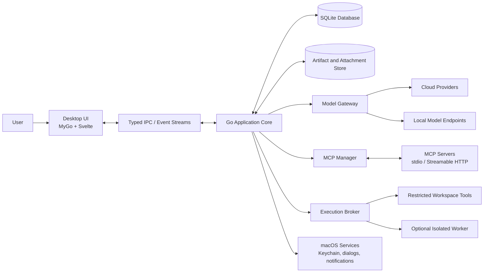

### Trust boundaries

- **UI boundary:** frontend can request actions, but cannot bypass Go policies or directly access secrets.
- **Provider boundary:** prompts and explicitly selected content may leave the device when a remote provider is selected.
- **MCP boundary:** MCP servers are external components and are not trusted by default, even if they run locally.
- **Execution boundary:** shell/scripts and file modifications must be mediated by the execution broker.
- **Storage boundary:** API keys/OAuth tokens belong in the OS credential store, not SQLite plaintext or model context.

## 7. Component architecture

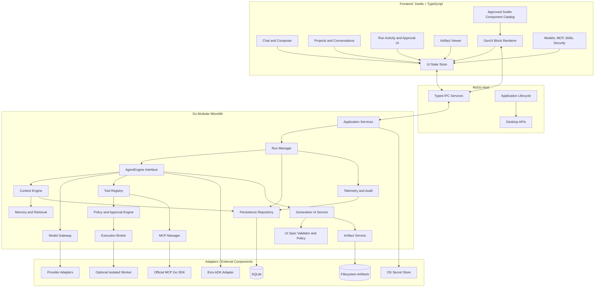

### Component responsibilities

| Component | Responsibility | Must not do |
|---|---|---|
| Desktop UI | Render messages, statuses, approvals, settings, artifacts | Execute shell, read secrets, call provider APIs directly |
| MyGo IPC services | Validate frontend requests and pass typed commands/events | Expose arbitrary Go reflection or unbounded filesystem access |
| Application services | Coordinate user-facing use cases | Contain provider-specific wire logic |
| Run manager | Run IDs, state transitions, cancellation, checkpoint/recovery | Construct prompts by concatenating all stored history |
| AgentEngine | Decide next model/tool step, emit domain events | Bypass policy or invoke raw OS APIs |
| Context engine | Select/compact prompt content within budget | Become the canonical store for conversation history |
| Model gateway | Select adapter, normalize provider events, retries and timeouts | Secretly change provider/model or discard provider errors |
| Tool registry | Register metadata/schema and resolve enabled tools | Auto-enable tools solely because an MCP server advertises them |
| Policy engine | Evaluate permissions, risk, approvals | Trust model-provided approval or user-visible text as authorization |
| Execution broker | Execute approved tool operation within constraints | Run raw shell strings without validation |
| MCP manager | Connect, list capabilities, monitor, and close MCP servers | Treat server descriptions as trusted system instructions |
| Artifact service | Save, version, preview, and export large outputs | Put entire artifacts back into context by default |
| Generative UI service | Build/validate UI block specs, bind data references, and emit typed UI events | Execute generated JS or invoke privileged operations directly |
| UI spec validator | Validate schema version, component allowlist, bindings, quotas, and action types | Trust model-provided component names or actions |
| UI block renderer | Render approved UI specs through Svelte components and design tokens | Compile arbitrary source code in the trusted application origin |
| Persistence | Transactional session/run state and event history | Store API keys or large binary payloads in normal tables |
| Audit/telemetry | Operational diagnosis and security events | Log raw secrets or sensitive full file contents by default |

## 8. Runtime and request lifecycle

### 8.1 End-to-end sequence

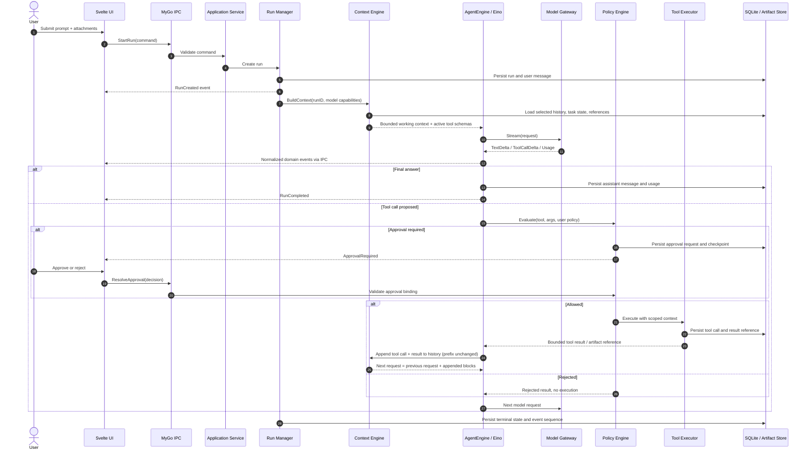

### 8.2 Agent loop flow

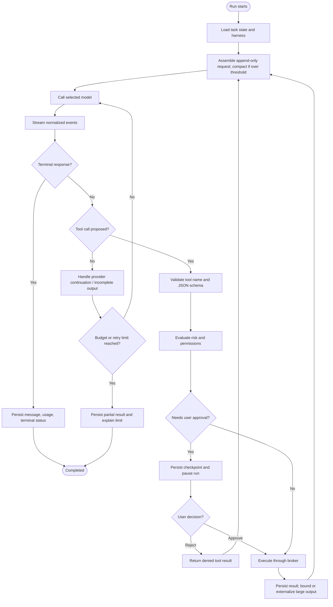

### 8.3 Run state machine

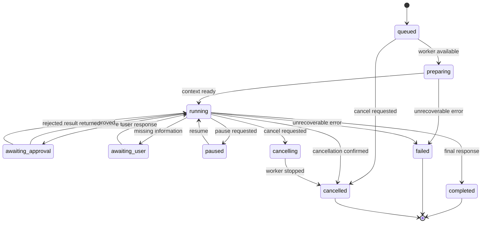

Every state transition must be persisted. A terminal state must not be silently replaced with another terminal state. A retry creates a new attempt associated with the original run or task, and the UI should make the relationship explicit.

## 9. Provider gateway and capability model

### 9.1 Model provider contract

All provider adapters map into an application-owned contract. The rest of the application does not import an OpenAI, Anthropic, Gemini, or Ollama SDK directly.

Illustrative Go interface:

```go
// Domain-level sketch; not a complete implementation.
type ModelProvider interface {
    ID() string
    ListModels(ctx context.Context) ([]ModelInfo, error)
    GetCapabilities(ctx context.Context, modelID string) (ModelCapabilities, error)
    Stream(ctx context.Context, req ModelRequest) (<-chan ModelEvent, error)
    Cancel(ctx context.Context, providerRunID string) error
}

type ModelCapabilities struct {
    Streaming        bool
    ToolCalling      bool
    Vision           bool
    AudioInput       bool
    AudioOutput      bool
    StructuredOutput bool
    ReasoningControl bool
    PromptCaching    bool
    MaxContextTokens int
    MaxOutputTokens  int
}
```

The actual implementation should separate known capabilities from unknown or estimated values. Do not infer maximum context/output from a model's marketing name. Use provider metadata when available and allow a validated user override when the provider cannot report it.

### 9.2 Adapter layout

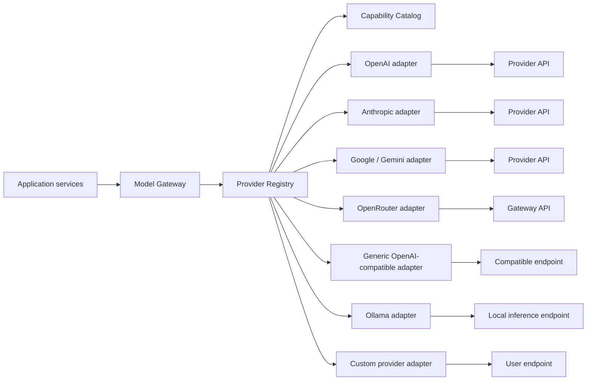

### 9.3 Provider behavior rules

- Keep stable model identity as `(provider_id, model_id)`, not model name alone.
- Separate provider credentials from model metadata.
- Preserve native options through a namespaced `provider_options` object.
- Normalize common stream events: text delta, reasoning metadata if provided, tool call, usage, finish reason, error, retry, and incomplete response.
- Do not fabricate reasoning tokens or usage values if a provider does not return them.
- Fallback must be explicit and visible. Do not silently send sensitive data to a different provider.
- Retry only errors considered retryable; use bounded exponential backoff with jitter and honor `Retry-After` when available.
- Treat cancellation as best effort at the provider boundary and stop local tool execution immediately when cancellation is accepted.
- Disable unsupported UI controls for a selected model and explain why.
- Never put API credentials in prompts, logs, events exposed to the frontend, or artifact metadata.
- **Cache invariants (ADR-0001):** store raw provider content blocks (including thinking and signatures) and replay them byte-identically; serialize JSON deterministically; set `prompt_cache_key` / `session_id` to a hash of the conversation ID; on Anthropic place breakpoint 1 at the end of system with TTL 1h, breakpoint 2 on the last block with TTL 5m, and breakpoint 3 only when one turn adds more than 20 blocks; no keepalive pings.
- Read cache usage from every provider (`cache_read_input_tokens`/`cache_creation_input_tokens`, `cached_tokens`, `prompt_cache_hit_tokens`/`prompt_cache_miss_tokens`, llama.cpp `timings.cache_n`) and record it.
- A golden test asserts that the serialized request of turn N is a byte-exact prefix of turn N+1 for each adapter.
- **Model switch:** allowed with a warning showing the estimated tokens re-read at full price (shown when history exceeds ~4,000 tokens). A provider switch re-serializes from canonical history and drops provider-specific blocks.

### 9.4 Local model providers

The application connects to local inference servers through an adapter. Local inference is not embedded into the main Go process in the MVP. This makes model-server lifecycle, memory use, and GPU selection independent from the desktop application's lifetime. The UI may optionally offer “start/stop local endpoint” integration later, but should not assume every model runtime can be controlled the same way.

## 10. Agent harnesses, tools, and MCP

### 10.1 Mode (harness profile)

In the UI and glossary this concept is called a **Mode**. A Mode determines the working environment for a run: instructions, tools, skills, workspace, permission profile, context budget, and output strategy. A model choice is a field in the harness, not the entire harness.

```go
// Conceptual domain schema.
type HarnessProfile struct {
    ID                 string
    Name               string
    ModelRef           ModelRef
    Instructions       []string
    SkillIDs           []string
    ToolsetIDs         []string
    WorkspaceID        string
    PermissionProfile  string
    SandboxProfile     string
    ContextPolicyID    string
    OutputPolicyID     string
}
```

Changing Mode mid-conversation changes tools and system prompt, so it resets the cache; it is allowed with the same warning as a model switch. Skill contents are loaded with a `load_skill` tool (tool result, append-only), never injected into the system prompt.

Initial built-in Modes:

- Chat: low tool exposure, concise interaction, no arbitrary execution.
- Research: web/search and document tools, sources and citations as artifacts.
- Writing: long-form generation, outline, section drafting, revision, compilation.
- Data analyst: spreadsheet/CSV, calculator/statistics, Python worker when enabled.
- Workspace assistant: files, document creation, organization, and approved edits.
- Coding: repo/filesystem, tests, Git, browser automation, and restricted terminal only when enabled.

A custom profile can select tools and policies without modifying the runtime. Profiles should be exportable as declarative configuration. Secret material, access tokens, and absolute home-directory paths must never be included in exported profiles by default.

### 10.2 Tool registry contract

Each tool exposes metadata and a JSON Schema input contract. The registry associates tool source, capability tags, risk, permissions, timeouts, output-size limits, and availability status.

```go
type ToolDefinition struct {
    ID                  string
    Name                string
    Description         string
    InputSchema         json.RawMessage
    Source              ToolSource // builtin, mcp, custom
    CapabilityTags      []string
    RiskLevel           RiskLevel
    RequiredPermissions []Permission
    Timeout             time.Duration
    MaxOutputBytes      int64
}
```

The model-facing tool schema is not the security policy. Policies are evaluated independently by the backend using the actual tool ID, arguments, workspace, user-configured rules, and operation risk.

### 10.3 MCP manager

Use the official Go MCP SDK for protocol implementation. Wrap it in an application-level `MCPManager` responsible for server configuration, lifecycle, transport, capability discovery, OAuth or other supported auth, health, logs, and policy binding.

Required features:

- Add/edit/remove a server, enable/disable it, and test its connection.
- Support local STDIO and remote Streamable HTTP transports where appropriate.
- Discover tools and schemas only after explicit connection/enablement.
- Bind every discovered tool to a permission profile and output/time limits.
- Terminate local server processes when disabled or when the application exits.
- Apply startup, call, and idle timeouts; cap concurrent calls; propagate cancellation.
- Treat tool descriptions, resources, prompt templates, and results as untrusted input.
- Require explicit user action before sending credentials or private data to remote servers.
- Expose a visible connection status and an actionable error for failed servers.
- Keep MCP server secrets in the OS credential store. Store only secret references in SQLite.

### 10.4 Progressive tool discovery

The tool list is frozen per conversation (ADR-0001), and most providers in use have no deferred tool loading, so discovery works through **fixed meta-tools** on every provider (ADR-0003):

- The Mode's core toolset is sent natively and frozen.
- `find_tools(query)`: local FTS over names, descriptions, and tags of enabled tools; returns the top 5 **with schemas**, capped at 8 KB, as a tool result.
- `call_tool(name, args)`: calls any enabled tool, discovered or not. Schema validation happens in Go (no strict decoding), and policy/approval is evaluated on the real tool ID; the approval UI shows the real tool.
- Tools found during a conversation are promoted to native only at compaction, when the prefix changes anyway.
- Enabling an MCP server mid-conversation makes its tools findable at once. Disabling it keeps native schemas in place; calls return "server disabled".
- `render_ui` and `create_artifact` are native with generic schemas; per-component documentation is loaded with `load_skill`.

**Code Mode (later phase, per model, off by default):** a fixed `run_script` tool runs model-written JS in QuickJS-WASM; inner calls go through the same dispatcher as `call_tool`. The dispatcher enforces per-tool concurrency limits, per-call timeouts, a script deadline and output cap, per-call policy (the script pauses for approval; parallel approvals are shown as one batch), and egress labels. The tool description never contains the tool catalog. It pays off on fan-out work (e.g. parallel web searches filtered in the sandbox) and is enabled only for models that pass the S3 gate.

## 11. Context Engine design

### 11.1 Design objective

Context management is a first-class subsystem. Its goal is not merely to truncate history. It must create the smallest sufficiently complete working context for the next model step while preserving the canonical conversation, task state, tool results, and artifacts in durable storage.

### 11.2 Separate storage from active context

- **Canonical history:** every message and normalized tool event saved in SQLite.
- **Task state:** structured goal, constraints, decisions, progress, pending actions, file references, and current plan.
- **Project memory:** selected summaries, durable facts, preferences, and decisions that may be relevant in future sessions.
- **Artifact store:** large inputs and outputs saved as files or structured data.
- **Active context:** a bounded assembly generated specifically for a provider/model request.

Do not automatically inject all project memory into all conversations. Retrieve memory only when the current request or workspace context needs it. Do not store inferred sensitive facts as durable memory without a clear product policy and user control.

### 11.3 Context budget algorithm

Let `W` be the model context window, `O` the requested output tokens, and `S` a safety reserve. The input budget is `B = max(0, W - O - S)`; if `W` is unknown, use a conservative configurable value and show the uncertainty.

The request is **not re-selected per step**. Its layout is fixed (ADR-0001):

```
[tools]          frozen per conversation, deterministic order and JSON
[system]         product rules + Mode instructions + skill index (names, one line each); no dates, cwd, or git state
[history]        append-only, byte-identical to what was first sent
[new user turn]  context note + user text
```

**Context note:** attached only to user turns, never to each agent step. It carries only what changed since the last note: the date when the day changes (day precision), workspace changes, attachments, and retrieved memory. Within a run, progress is visible from the tool-call history itself.

**Compaction** happens when history reaches ~75% of `B`, or on user request (§11.5). Nothing else may change the prefix except a model or Mode switch, which the user confirms.

### 11.4 Context-building flow

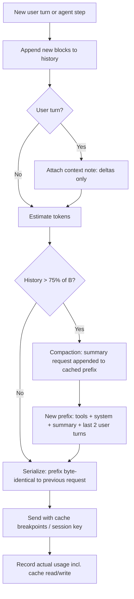

### 11.5 Compaction policy

Trigger: ~75% of the input budget or user request. The summary request is appended to the cached prefix, so the summarizing call itself hits the cache and uses the same model. The new request is `[tools][system][structured summary][last 2 user turns verbatim with complete tool-call pairs]`, costing one cache miss, after which it is append-only again. Tools discovered during the conversation are promoted to native at this point.

Compaction must happen at safe boundaries, not inside an incomplete tool call or a provider-specific message structure. A compaction result should contain:

- Task goal and acceptance criteria.
- User constraints and decisions.
- Facts and assumptions supported by evidence.
- Files/artifacts created or read, referenced by stable IDs.
- Tool calls completed and the relevant outcome, not necessarily their full output.
- Current plan and next actions.
- Open questions, failure state, and unresolved approvals.

Store the old context and new summary separately so debugging and recovery remain possible. Compaction should be deterministic in structure even if the summary text is generated by a model. Record when it happened and which content was included or omitted.

### 11.6 Tool output management

- Apply per-tool byte and item limits before output enters the model context.
- For large outputs, store the full result as an artifact and return a concise summary plus a stable artifact reference.
- For dataframes, return schema, row count, selected aggregates, and a small sample by default. Provide paging or filtered queries when necessary.
- For browser/research tools, preserve source URLs, titles, timestamps, and excerpts needed to support claims.
- Never return huge base64 blobs, entire binary documents, or full datasets as raw prompt text.
- Make truncation explicit. A tool result must say whether it was truncated and how to fetch more.

### 11.7 Prompt caching

Prompt caching is a design constraint, not an optimization pass. The layout in §11.3 and the invariants in §9.3 apply to every adapter. Known causes of cache misses in other harnesses (timestamps in system prompts, re-rendered history, tool lists that change, per-step state at the front, missing session keys, provider routing) are each ruled out by a specific rule. Targets and measurement: `docs/spike-plan.md` gate "Cache" (golden prefix test 100%; ≥80% of input tokens cached from turn 3 on DeepSeek and OpenRouter). Evidence: `research/prompt-caching.md`.

### 11.8 Token accounting and estimation

Record both the provider's actual usage and the application's preflight estimate. An estimate is not an actual usage figure. Tokenizer adapters may be provided for selected models, but the system must remain functional when exact tokenization is unavailable. Maintain rolling estimation accuracy per model/provider and use a conservative margin for unknown tokenization or tool-schema overhead.

## 12. Long-form generation and artifacts

Long-form generation is a task workflow, not one unbounded response. The user should be able to request a long report, book-length draft, large code scaffold, or multiple office artifacts. The engine creates a plan and generates bounded sections that are persisted as they complete.

### 12.1 Workflow

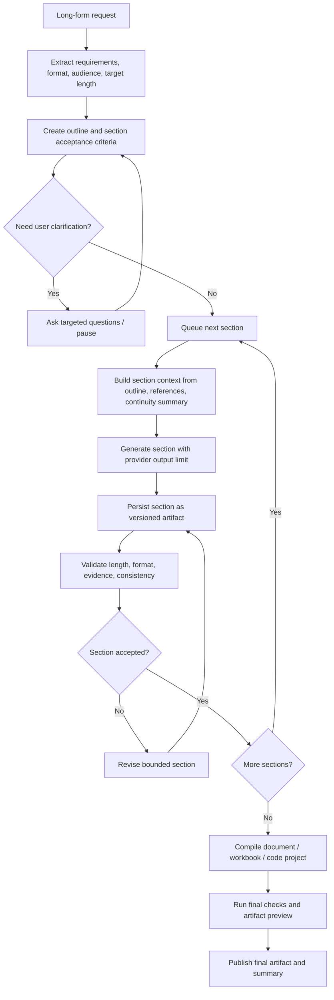

### 12.2 Requirements

- A generation task has its own ID, plan, section states, token/cost budget, and artifact IDs.
- Each section is committed to disk/database when complete; a crash must not discard finished sections.
- The active context includes the outline, local section requirements, a short continuity summary, and selected references, not every previously generated paragraph.
- Provide pause/resume, cancel, regenerate section, rewrite selection, continue, and export.
- Store output versions instead of overwriting user-approved work silently.
- Validate that output file size, format, citations, and section count are within policy.
- Allow user-configured output/token/cost budgets, but clamp them to provider capabilities and safety limits.
- If output is cut off by provider limits, persist a partial section and continue only through a controlled continuation flow.

### 12.3 Artifact types for MVP

- Markdown and plain text.
- Code files and project scaffolds.
- CSV/JSON and tabular outputs.
- HTML preview for generated charts/reports.
- DOCX/PDF export can be phased in after a reliable artifact and conversion pipeline exists.


## 12A. Generative UI and interactive explanations

### 12A.1 Product capability

Sasmita supports **Generative UI (GenUI)**: the agent can produce structured, interactive visual explanations that appear inline in the chat stream. A GenUI block may contain a chart, table, diagram, mathematical expression, metric card, heatmap/grid, comparison panel, interactive form, timeline, or a small simulation surface.

The supplied reference experience is a useful target: an explanation can combine segmented controls, a parameter slider, a 16×16 cell grid, a legend, summary metrics, probability bars, comparison cards, and a replay button in one inline block. The content should remain part of the conversation, rather than forcing the user to open a separate dashboard for every explanation.

GenUI is not limited to data visualization. It is a presentation and interaction layer for agent work. It can make abstract concepts easier to understand, expose assumptions, and let users explore parameter changes while keeping the underlying computation and data provenance inspectable.

### 12A.2 Supported output classes

The first component catalog should be intentionally small and composable:

| Component class | Examples | Initial behavior |
|---|---|---|
| Text and explanation | Markdown, callout, footnote, citation | Static content |
| Data visualization | Line/bar/scatter/pie chart, histogram, heatmap | Interactive tooltips, bounded filtering |
| Tabular | Data table, comparison table, KPI grid | Sorting/filtering where defined; pagination for large data |
| Diagram | Mermaid flowchart/sequence/state diagram | Render from validated diagram text; no arbitrary HTML |
| Mathematical | Formula, equation, variable explanation | Static or parameter-bound display |
| Interactive controls | Slider, checkbox, select, segmented control, button, tabs | Typed state changes and approved actions only |
| Simulation | Parameterized grid, stochastic experiment, what-if model | Deterministic local interaction or bounded backend computation |
| Process visualization | Timeline, progress, workflow, tool execution map | Updated from run events |
| Media | Image, audio waveform, video preview | Host-controlled source and size policies |
| Artifact preview | Markdown, CSV, image, chart, generated document | Read-only preview plus explicit export/open actions |

A component is included only when it has a defined schema, accessibility behavior, resource limits, and tests. The catalog is versioned and may be extended without changing the agent runtime contract.

### 12A.3 Three generation paths

Sasmita supports three distinct origins for visual UI:

1. **Native Sasmita UI spec:** the agent emits a typed JSON specification; Sasmita validates it and renders approved Svelte components. This is the default path for model-created charts, explainers, grids, and simulations.
2. **Tool-produced UI/data:** a built-in tool or analysis worker computes data and returns a data artifact/reference plus a small rendering specification. This is preferred for large datasets and numerical analysis because data processing stays outside the prompt.
3. **MCP App UI:** an MCP server may expose a UI resource associated with a tool. Sasmita may render it only in a separate sandboxed view with explicit capability and network policy. MCP App UI is not trusted as a native Sasmita component.

4. **Sandboxed artifact (Tier 2):** model-written single-file HTML or React/JSX, for new interactive explanations and simulations that no catalog component covers (for example a neural-network training explainer with a learning-rate slider). Contract (ADR-0004):
   - JSX is transpiled with esbuild in Go and served from `artifact://<id>/` with CSP `sandbox allow-scripts; default-src 'none'; connect-src 'none'; …`. Not `srcdoc`, which inherits the trusted UI's CSP.
   - The iframe has `sandbox="allow-scripts"` only; never `allow-same-origin`. The main window blocks top-level navigation to `artifact://`. Scheme handlers have no side effects.
   - **Artifact runtime** `artifact-runtime/1`, bundled locally via import map: React + ReactDOM, d3, Chart.js, lucide, Tailwind browser runtime, three.js core + OrbitControls. Imports outside the list fail with a clear error; no CDN.
   - Bridge v1 (postMessage, whitelisted by the host): `resize`, `reportError`, `saveState`/`loadState` (≤32 KB), `getData(ref)` read-only for refs in the manifest, `suggestPrompt(text)` (fills the composer; the user still presses Send). No tools, files, network, or IPC.
   - Edits: `create_artifact`, `edit_artifact(id, edits[{old,new}])` exact match (0 or >1 match is rejected with an error to the model), `rewrite_artifact`. Every change is a new immutable version.
   - Limits: source ≤512 KB, data per ref ≤5 MB, network always denied, at most 2 live iframes and 1 WebGL context.
   - The iframe shares the WebContent process with the chat (WebKit site isolation is off). A Go watchdog reloads the page if the main thread stops responding for ~3 s and marks the offending artifact "froze the view" (no auto-run). "Open in separate window" uses an `Untrusted` window with its own process.

Multi-file projects remain an ordinary artifact workflow and are never executed inline.

### 12A.4 Protocol strategy: internal contract first

Sasmita should own a stable internal `sasmita.ui/v1` schema and typed event model. Protocol adapters can be added for external standards:

- **A2UI:** evaluate as an interchange format for declarative, agent-driven UI descriptions. A2UI describes UI intent and lets the host render it using its own component catalog.
- **AG-UI:** evaluate as an agent-to-frontend event protocol for run lifecycle, text/tool streaming, shared state, and UI-related events. It is not a component library by itself.
- **MCP Apps:** support as an MCP extension for server-provided interactive UI resources rendered in an isolated host-controlled environment.

Do not implement all protocols in the MVP. First implement the internal schema and event mapping. Add A2UI or AG-UI adapters only when interoperability or a second frontend becomes a concrete requirement. Add MCP Apps after the WebView isolation and bridge threat model passes a dedicated technical spike.

### 12A.5 Internal UI block contract

A message may contain multiple ordered content blocks. Text and UI blocks are stored as separate typed items; the renderer must not parse executable UI from Markdown text.

```json
{
  "schemaVersion": "sasmita.ui/v1",
  "blockId": "uib_01J...",
  "kind": "interactive",
  "title": "Rounding behavior explorer",
  "summary": "Compare deterministic and stochastic rounding.",
  "layout": {
    "mode": "inline",
    "columns": 2
  },
  "state": {
    "resolution": "cell",
    "outlierThreshold": 76,
    "trueValue": 2.25
  },
  "data": {
    "source": "artifact://data/rounding-simulation-01",
    "encoding": "application/json",
    "sha256": "<content-hash>"
  },
  "components": [
    {
      "id": "resolution-mode",
      "type": "segmented-control",
      "label": "Grid resolution",
      "bind": "state.resolution",
      "options": ["sample", "cell"]
    },
    {
      "id": "outlier-threshold",
      "type": "slider",
      "label": "Outlier threshold",
      "bind": "state.outlierThreshold",
      "min": 0,
      "max": 100,
      "step": 1
    },
    {
      "id": "rounding-grid",
      "type": "heatmap-grid",
      "dataRef": "data.source",
      "rows": 16,
      "columns": 16,
      "legendRef": "data.legend"
    },
    {
      "id": "simulation-summary",
      "type": "metric-grid",
      "dataRef": "data.summary"
    }
  ],
  "actions": [
    {
      "id": "rerun",
      "type": "run-computation",
      "handler": "builtin.rounding-simulation.v1"
    }
  ]
}
```

The example is illustrative, not the final JSON Schema. The production schema must define exact field types, required fields, limits, enums, binding rules, and compatibility behavior. Opaque artifact references are resolved by the host; they are not arbitrary filesystem paths or URLs supplied directly to the renderer.

### 12A.6 UI generation and rendering flow

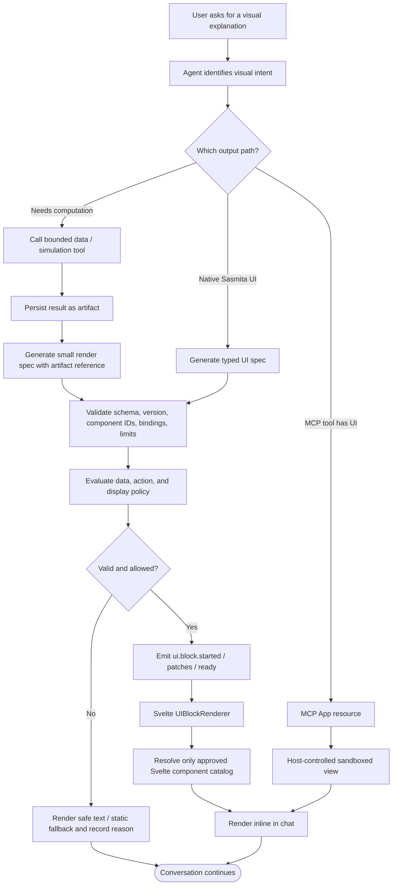

### 12A.7 Interaction and state flow

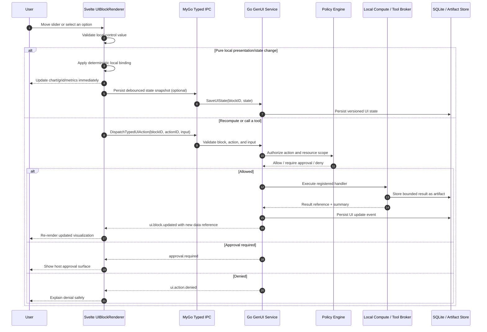

### 12A.8 Agent-to-UI authoring rules

- **Visual-first for explanations:** for questions about a concept or process, the agent creates the visual first (`render_ui` or `create_artifact`) and then writes paragraph text below it that refers to the visual. Simple answers stay text. Rendering order equals emission order; the extra model step still hits the cache.
- Routing: Tier 1 UI blocks for charts, tables, diagrams, and KPIs bound to catalog components and data; Tier 2 sandboxed artifacts for new simulations and interactive explainers.
- The agent emits a structured spec through a dedicated `render_ui`/`create_visualization` capability or structured model output. It does not write arbitrary source code into the trusted message renderer.
- The model receives a compact description of available UI capabilities and only the schemas relevant to the current task. Do not inject the entire component catalog into every prompt.
- Each block has a stable ID, schema version, data provenance, and explicit display mode.
- A visual must distinguish measured/source data from generated or illustrative data. Include source labels, units, assumptions, and uncertainty where applicable.
- If model structured output is unsupported, use a tool call with a constrained JSON schema or fall back to text and static artifacts.
- Unknown component types, unsupported bindings, invalid data references, and incompatible schema versions fail closed.
- Every visual should have an accessible textual summary and a non-interactive fallback where reasonable.

### 12A.9 State, computation, and interaction model

Classify interactions into three levels:

1. **View-local:** selecting a tab, changing a display mode, sorting a small table, or adjusting a visual filter. Execute locally in Svelte and do not call the model.
2. **Deterministic recompute:** changing a parameter in a known simulation or calculation. Prefer a registered deterministic Go computation or a restricted expression AST. Do not use `eval`, `new Function`, dynamic imports, or model-supplied JavaScript.
3. **Agent/tool action:** requesting new reasoning, reading another file, querying a remote service, writing an artifact, or executing a privileged operation. Send a typed action to Go; route it through the existing policy/approval/execution broker.

The first implementation should support local state bindings and a small set of registered computation handlers. A future expression engine may support a restricted, typed expression tree with bounded operators, recursion depth, and evaluation steps. It must never be a general-purpose code interpreter.

Persist the initial UI spec and meaningful state transitions. Do not persist every mouse move or slider pixel. Debounce state snapshots and save only user-committed or task-significant states. For deterministic visual interactions, the same state and input data should produce the same output.

### 12A.10 MCP App isolation requirements

MCP Apps are treated as third-party UI, even when the associated tool is enabled. Render them in a separate sandboxed frame/view with a narrow message bridge. The host retains control over display mode, origin, navigation, network policy, and available capabilities.

- No access to the host DOM, Sasmita application state, cookies, Keychain, or unrestricted filesystem.
- No direct access to MyGo IPC or privileged native APIs.
- Deny network access by default; allow only declared and user-approved destinations where the protocol and host implementation support enforcement.
- Validate message origin, source window, message schema, and resource identity. Reject unknown message types.
- Do not grant top navigation, popups, clipboard, downloads, or external links without explicit policy.
- A UI-to-tool request returns to the MCP/Tool broker and passes the same schema, permission, and approval checks as any other tool call.
- If the MyGo WebView cannot enforce the required isolation reliably, defer MCP Apps or open them in a separately isolated runtime. Do not weaken the trust boundary to ship the feature.

### 12A.11 Context and token efficiency

GenUI must not turn the entire Svelte component catalog into prompt overhead. The context engine should expose a compact capability summary and progressively discover detailed schemas only when the agent chooses to create a specific visual type.

- Send labels, dimensions, column metadata, statistical summaries, and artifact references instead of entire datasets.
- Keep UI data payloads out of the LLM conversation history unless the model needs a small sample or summary for reasoning.
- Store large chart series and grids as artifacts; fetch/render them through bounded data APIs.
- Reuse stable component IDs and design tokens; avoid regenerating a long description of every style property.
- Use small, typed state patches for interactions instead of resending the full UI specification.
- Track tokens used to author/repair UI specs separately from normal text output.
- Cache validated component metadata locally; invalidate on schema version change.

### 12A.12 Performance and payload guardrails

Initial guardrails for the prototype (to be measured and revised, not treated as achieved performance):

| Limit | Initial target | Handling when exceeded |
|---|---:|---|
| UI spec payload excluding data | 256 KB | Reject or split into multiple blocks |
| Component nodes per block | 100 | Simplify layout or split blocks |
| Interactive controls per block | 20 | Ask agent to simplify or use a dedicated artifact |
| Inline table rows | 200 | Paginate or open full table artifact |
| Inline chart points per series | 5,000 | Downsample or load a selected range |
| Grid cells inline | 4,096 | Use canvas/virtualized grid or artifact view |
| UI state patch | 32 KB | Send a new state snapshot or artifact reference |
| UI update frequency | 10 updates/second per block | Coalesce/throttle intermediate updates |

Load heavy renderers (for example Mermaid or advanced charting) on demand. Prefer SVG for small diagrams, canvas or WebGL only when justified by measured data sizes, and virtualized DOM for long tables. Avoid mounting hidden renderers for every message. Limit concurrent active interactive blocks and release subscriptions/listeners when a conversation view is destroyed.

### 12A.13 Failure and fallback behavior

- Invalid spec: show a concise explanation and preserve the agent's textual answer.
- Unknown component: render an unsupported-component placeholder or safe text fallback.
- Missing artifact/data reference: show retry/open-source diagnostics rather than an empty chart.
- Renderer crash: isolate the block; do not crash the full chat window.
- Unsupported interaction: disable the control and explain why; never silently turn it into a tool action.
- Unsupported provider structured output: use constrained tool-call generation or produce text plus a static artifact.
- MCP App failure: show server name, permission status, and a retry/disable option; do not grant wider privileges as a workaround.

### 12A.14 Acceptance criteria

- An agent can create at least one chart, one Mermaid diagram, one table, and one interactive simulation block inline in a chat message.
- The interactive simulation matching the reference pattern can contain parameter controls, a grid/heatmap, legend, KPI metrics, comparison cards, and a rerun action.
- View-local controls update without an additional LLM request.
- Recompute and external actions are routed through a typed Go handler and policy evaluation.
- UI blocks survive conversation reload and can be re-rendered from persisted spec plus artifact references.
- Large data remains outside message prompts and is fetched through bounded artifact/data APIs.
- Unknown components and invalid specs fail closed with a useful text fallback.
- No model-generated JavaScript runs in the trusted Sasmita application origin.
- MCP Apps are disabled until isolation and message-bridge tests pass.


## 13. Persistence model

### 12A.15 Rendering lifecycle (lean)

Validated by the prototype on branch `prototype/genui-rendering-flow`:

- While tool arguments stream, show a skeleton. An artifact never runs before it is stored; its code can be viewed as it arrives. An invalid spec renders text fallback plus reason, and the error goes back to the model.
- UI blocks use no iframe slot; the virtualized message list unmounts them off-screen.
- Sandboxed artifacts run automatically when visible, including when a conversation is reopened, within the slot limit (2 live, 1 WebGL). Priority: expanded, then last clicked "Run", then most recently visible. Losers show a "slots full" card.
- Off-screen: `saveState`, destroy the iframe, show a card (title, version, summary, Run). Image snapshots wait until the spike proves capture from an opaque-origin iframe.
- Watchdog reload kills all live iframes, reallocates slots, and keeps the offender off auto-run (Retry / Open in separate window / View code).
- A block that was streaming when the app closed is marked "interrupted" with "Ask the model to continue".
- A successful edit reloads the live iframe with the new version plus `loadState`; a failed edit leaves the version unchanged.

## 13. Persistence model

### 13.1 Data ownership

SQLite stores metadata and lifecycle state. Filesystem storage holds larger payloads. All DB records use stable IDs, timestamps, and schema migration versions. Use transactional writes for coupled state changes such as approval/checkpoint transitions and tool execution events.

### 13.2 Core entities

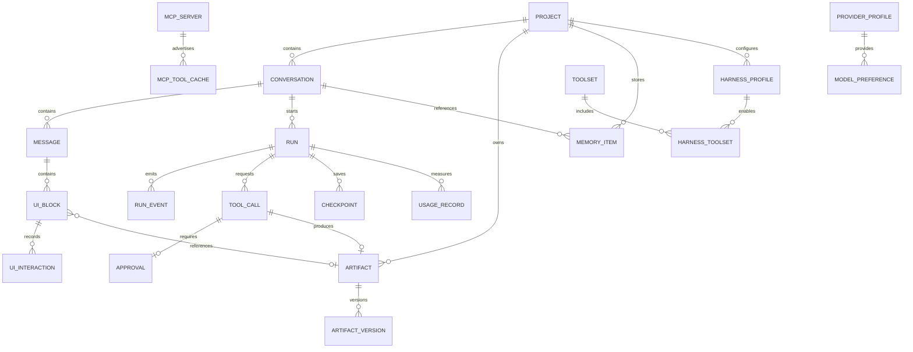

### 13.3 Table intent

| Table | Core fields | Notes |
|---|---|---|
| `projects` | `id`, `name`, `root_uri`, `created_at`, `updated_at` | Workspace root is an approved URI/path, not unrestricted authority |
| `conversations` | `id`, `project_id`, `title`, `active_harness_id`, timestamps | Index by project and update time |
| `messages` | `id`, `conversation_id`, `role`, `content_json`, `created_at` | Keep multimodal references and tool call IDs structured |
| `runs` | `id`, `conversation_id`, `status`, `model_ref`, `harness_id`, `started_at`, `finished_at` | Durable lifecycle state |
| `run_events` | `id`, `run_id`, `seq`, `event_type`, `payload_json`, `created_at` | Monotonic sequence per run; redact sensitive fields |
| `tool_calls` | `id`, `run_id`, `tool_id`, `input_json`, `status`, `result_ref`, timestamps | Result may point to an artifact |
| `approvals` | `id`, `tool_call_id`, `decision`, `policy_snapshot`, timestamps | Approval applies to the exact arguments/hash and policy context |
| `checkpoints` | `id`, `run_id`, `engine_state_ref`, `schema_version`, timestamp | Store serialized engine state only through a versioned adapter |
| `provider_profiles` | `id`, `provider_id`, `display_name`, `base_url`, `secret_ref` | Never persist raw API keys here |
| `model_preferences` | `id`, `provider_profile_id`, `model_id`, `capabilities_json`, `limits_json` | Cache metadata with last-verified timestamp |
| `mcp_servers` | `id`, `name`, `transport`, `endpoint_or_command`, `enabled`, `secret_ref` | Validate command and endpoint; secret values are stored elsewhere |
| `mcp_tool_cache` | `id`, `server_id`, `tool_name`, `schema_json`, `last_seen` | Cache is refreshable, not trusted policy |
| `toolsets` | `id`, `name`, `tool_ids_json`, `policy_id` | Bundles of tools |
| `harness_profiles` | `id`, `name`, `model_ref`, `instructions_json`, `policy_id`, `context_policy_id` | Versioned configuration |
| `skills` | `id`, `name`, `content_ref`, `enabled`, `trust_level` | Skills are untrusted input until reviewed/approved |
| `memory_items` | `id`, `project_id`, `kind`, `content`, `source_ref`, `confidence`, `updated_at` | Retrieval is scoped and opt-out capable |
| `artifacts` | `id`, `project_id`, `kind`, `uri`, `mime_type`, `size_bytes`, `sha256` | Payload stored on disk; DB stores metadata |
| `artifact_versions` | `id`, `artifact_id`, `version`, `uri`, `created_at` | Immutable version history for important outputs |
| `artifacts` (Tier 2 fields) | `runtime_version`, `source_kind` (`html`/`jsx`), `manifest_json` (declared data refs), `status` (`ok`/`froze_view`) | Versions immutable; source served only through `artifact://` |
| `ui_blocks` | `id`, `message_id`, `schema_version`, `kind`, `spec_json` or `spec_ref`, `status`, `created_at` | Validated declarative UI; large data stays in artifact storage |
| `ui_interactions` | `id`, `ui_block_id`, `action_id`, `state_patch_json`, `actor`, `created_at` | Persist meaningful user actions/state changes, not every pointer event |
| `usage_records` | `id`, `run_id`, `provider_id`, `model_id`, `input_tokens`, `output_tokens`, `cache_read_tokens`, `cache_write_tokens`, `uncached_tokens`, `estimated`, `cost_estimate` | Estimated metrics must be marked as estimated |
| `audit_events` | `id`, `actor`, `action`, `resource_ref`, `decision`, timestamp | Security-focused; avoid storing full sensitive payloads |

### 13.4 Storage and lifecycle rules

- Enable SQLite foreign keys and appropriate busy timeout; use WAL after testing the chosen driver and backup process.
- Apply versioned migrations and test migration from the last released schema.
- Store attachments/artifacts under an application-managed directory with stable opaque IDs, not user-controlled path fragments.
- Use a checksum and atomic-write/rename for generated artifacts.
- Add a user-facing data export and deletion capability.
- Do not automatically delete session history. Offer retention controls and a documented cleanup operation for temporary data.
- Provide backup/restore that includes database and artifact files in a consistent snapshot.
- Consider SQLCipher or filesystem-level encryption only after evaluating dependency, portability, and backup implications; OS disk encryption alone should not be represented as app-level database encryption.

## 14. IPC contract and event model

### 14.1 Frontend-to-backend commands

Use typed MyGo bindings for request/response operations. For long-lived streams, use a bounded event/channel abstraction with cancellation and stable run IDs. Do not expose an arbitrary RPC endpoint or `eval` bridge for privileged actions.

Initial command surface:

- `CreateConversation(projectID, title, harnessID)`
- `ListConversations(projectID, cursor, limit)`
- `GetConversation(conversationID)`
- `StartRun(StartRunRequest)`
- `CancelRun(runID)`
- `PauseRun(runID)`
- `ResumeRun(runID)`
- `ResolveApproval(approvalID, decision)`
- `ListProviders()` / `ValidateProviderProfile(profileID)`
- `ListModels(providerProfileID)`
- `ListMCPServers()` / `TestMCPServer(serverID)` / `SetMCPServerEnabled(serverID, enabled)`
- `ListTools(harnessID)`
- `ListArtifacts(projectID, cursor, limit)` / `OpenArtifact(artifactID)` / `ExportArtifact(artifactID, destination)`
- `UpdateHarnessProfile(profile)`
- `GetRunSnapshot(runID)`
- `GetUIBlock(blockID)` / `SaveUIState(blockID, state)`
- `DispatchUIAction(blockID, actionID, input)`
- `GetUIBlockData(blockID, dataRef, cursor, limit)`

### 14.2 Domain events

```go
type RunEvent struct {
    RunID     string          `json:"runId"`
    Seq       uint64          `json:"seq"`
    Type      string          `json:"type"`
    Timestamp time.Time       `json:"timestamp"`
    Payload   json.RawMessage `json:"payload"`
}
```

Event types should be versioned and include at least:

- `run.queued`, `run.started`, `run.paused`, `run.resumed`, `run.completed`, `run.failed`, `run.cancelled`
- `model.request_started`, `model.text_delta`, `model.tool_call_delta`, `model.usage`, `model.retry`, `model.error`
- `tool.proposed`, `tool.approval_required`, `tool.started`, `tool.progress`, `tool.completed`, `tool.failed`, `tool.denied`
- `context.compacted`, `context.budget_warning`
- `artifact.created`, `artifact.updated`, `artifact.ready`
- `ui.block.proposed`, `ui.block.validated`, `ui.block.started`, `ui.block.patch`, `ui.block.ready`, `ui.block.updated`, `ui.block.failed`
- `ui.action.requested`, `ui.action.approval_required`, `ui.action.completed`, `ui.action.denied`
- `mcp.connected`, `mcp.disconnected`, `mcp.error`

### 14.3 Streaming/backpressure

- Persist important lifecycle events and approval transitions. Token deltas can be coalesced for UI rendering if event pressure is high; do not persist every individual token unless there is a specific debugging mode.
- Bound channel buffers. When a frontend is disconnected, the run must continue or pause according to policy, and the UI can recover from `GetRunSnapshot` plus persisted events.
- Never drop terminal state or approval events.
- Use cancellation contexts all the way from UI to provider and tool executor.
- Redact credentials and sensitive input fields before events cross IPC.
- UI patches are schema-validated and bounded; coalesce slider/drag events and preserve terminal `ui.block.ready`/`ui.block.failed` events.
- A UI interaction must carry the block ID, action ID, schema version, and typed input. The Go host revalidates all of them; frontend validation is usability, not authorization.

## 15. Permissions, sandboxing, and security

### 15.1 Threat model

Treat the following as potentially untrusted: user-provided documents, web pages, model output, tool descriptions, MCP server responses, imported skill files, and external harness output. The system must defend against prompt injection, path traversal, malicious MCP tools, unintended network transfer, command injection, credential leakage, oversized output, and runaway loops.

### 15.2 Permission layers

1. **Capability permission:** whether the harness may use a category of tools.
2. **Resource scope:** which project, directories, files, repositories, or endpoints are in scope.
3. **Operation policy:** read, create, modify, delete, execute, publish, or transmit.
4. **Risk/approval policy:** whether an action runs automatically, requires approval, or is always denied.
5. **Isolation policy:** which executor/environment can run it.

### 15.3 Default policy matrix

| Operation | Default | Reason |
|---|---|---|
| Read user-selected file | Allow after selection | User intentionally supplied the file |
| Read within approved workspace | Allow if harness scope permits | Bounded local context |
| Read outside workspace | Deny until explicitly granted | Prevent broad home-directory access |
| Create artifact within workspace | Allow or ask based on profile | Reversible and scoped |
| Overwrite existing user file | Approval required | Can destroy user work |
| Delete/move many files | Approval required; deny bulk by default | High-impact operation |
| Shell execution | Mode Coding only, opt-in, inside Seatbelt; per-command approval; disabled if `sandbox-exec` is unavailable | Arbitrary command risk |
| Run Python for analysis | Allow without approval (Pyodide: no network, no host FS) | Isolated runtime; output becomes an artifact |
| Save analysis output to a user file | Approval (overwrite rules) | Can change user work |
| Install dependencies / mutate system | Approval plus isolated worker | Can alter system state |
| Send email, publish, purchase, or external write | Approval required | External side effect |
| Upload private file to remote provider | Explicit disclosure/consent based on policy | Data egress boundary |
| Read secret store | Deny model/tool access | Credentials must remain outside context |

### 15.4 Execution broker rules

- Accept structured operations, not raw shell commands, wherever possible.
- If an executable is invoked, use a fixed executable path or allowlisted executable, argument array, clean environment, working-directory scope, timeout, output cap, and cancellation.
- Never interpolate model text into a shell command string.
- Canonicalize file paths and validate symlink behavior before file reads/writes.
- Use atomic writes and preserve a backup/version before overwriting important artifacts.
- Limit concurrent process count, CPU time where practical, runtime, disk output, and network access.
- Avoid inheriting secrets or the full parent environment.
- Shell commands in Mode Coding run as `/usr/bin/sandbox-exec -f <profile>` with a `(deny default)` profile derived from Codex: write only workspace and temp, `.git` read-only, network off. Compound commands are split before allow/ask/deny rules are matched. Leaving the sandbox (network, paths outside the workspace) always asks and cannot be "always allowed". There is no bypass mode.
- For arbitrary code, use an isolated worker with a clearly documented security boundary. If no suitable worker is available, refuse arbitrary execution rather than calling an ordinary subprocess a sandbox.

### 15.5 MCP safety

MCP tool schemas are data from a server, not proof that the action is safe. Validate all arguments and permissions locally. Remote MCP authorization must use the supported authorization flow; never place a long-lived bearer token in a command string or tool description. Keep local server launch commands on an explicit allowlist or ask the user to confirm first. Bound tool output before it is added to the prompt.

### 15.6 Secret handling

Implement `SecretStore` as a port. On macOS use Keychain; use the OS credential store equivalent on other platforms. The UI can request storing or deleting a credential but cannot read arbitrary secret values after storage. Provider adapters receive secrets only at the point of making a request. Logs, events, crash reports, and exported configurations must be scrubbed.

### 15.7 Generative UI and embedded view security

- Model-generated UI is declarative data. The trusted renderer uses a finite component allowlist and never evaluates generated JavaScript, HTML event handlers, dynamic imports, or arbitrary CSS.
- Escape and sanitize text, Markdown, Mermaid labels, URLs, and user-controlled values. Validate all bindings and action IDs against the block schema.
- A visual control can change local presentation state only within its declared block. It cannot call a tool, read a file, access a secret, or make a network request directly.
- Any operation beyond local presentation is sent as a typed action to Go and follows the normal permission broker.
- Tier 2 artifacts: iframe `sandbox="allow-scripts"` loaded from `artifact://` with a CSP header (never `srcdoc`, never `allow-same-origin`); the main window rejects main-frame navigation to `artifact://`; scheme handlers reject side effects; the host checks `event.source` and `event.origin === "null"` and whitelists bridge messages. This is JavaScript-level isolation, not protection against renderer exploits; if the threat model changes, move artifacts to a separate process.
- MCP Apps and generated-code previews are separate trust domains. Use a sandboxed frame/worker with a strict message bridge and deny-by-default network policy. Never expose MyGo IPC to an embedded third-party view.
- Enforce payload, node, point, render-time, and memory limits. A malformed or oversized block must fail independently without affecting the conversation renderer.

### 15.8 Security approval flow

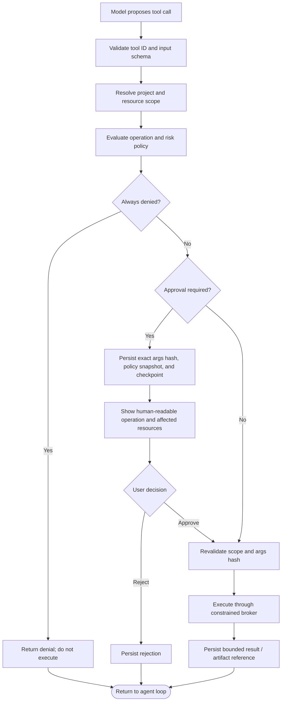

Approval is bound to the exact operation, parameters, workspace, and policy version. If the request changes, the approval is invalid and must be requested again.

## 16. Memory, project search, and retrieval

### 16.1 Memory types

- **Conversation memory:** the canonical messages within a conversation.
- **Task state:** current goal, constraints, plan, completed actions, and pending actions.
- **Project memory:** user-approved project facts and decisions, with source references.
- **Knowledge retrieval:** document chunks or notes retrieved for a particular query.
- **User preferences:** optional explicit preferences with controls to inspect/edit/delete.

Do not treat these as one unbounded “memory prompt”. Each type has separate retrieval and retention rules.

### 16.2 Retrieval strategy

Start with SQLite full-text search and metadata filters. This is simpler and often enough for local project notes, titles, messages, and small document collections. Add embeddings/vector search only when evaluation demonstrates a meaningful retrieval improvement. The embedding model and vector store must be optional, lazily loaded, and independent from the core application process if resource costs warrant it.

Every retrieved memory item should carry provenance, timestamp, project scope, and a relevance score or retrieval rationale. User-provided content retrieved from files remains untrusted and must not override system or policy instructions.

## 17. UI information architecture

Visual tokens, typography, components, motion, and the anti-slop rules live in `DESIGN.md`. Product truth lives in `PRODUCT.md`.

### 17.1 Navigation

- Chat-centered. Sidebar: New chat, Search, Projects, Artifacts (library), then recent conversations. Settings (Connections, Modes, Permissions, Storage, Diagnostics) sits at the bottom. No separate Activity page.
- The sidebar collapses to a 64px icon rail (header button or ⌘\); expanded by default.
- Projects are optional. A conversation outside a project has no workspace folder access; files enter only as attachments.
- Header: conversation title, Mode label, and a **Chat | Baca** switch. Baca (reading) uses the rail and a 1040px column.

### 17.2 Conversation surface

- Composer: `[Mode ▾] [Model ▾] [attach]` chips inside the composer.
- Each answer starts with one collapsed activity line ("Bekerja 5 dtk ›") that expands to a timeline with tool chips. Approval cards appear inline where the run stops. Runs in other conversations show a sidebar badge; macOS notifications only when the app is not frontmost.
- Visual + text formats: **1 column** (default in Chat), **2 columns below** (default in Baca), **side by side**.
- Artifacts are inline by default; "Open beside chat" opens a right panel (the chat stays visible) with a **Full screen** option (Esc exits). "Open in separate window" remains for isolation.
- Changing model or Mode shows a popover with the estimated tokens re-read at full price, only when history exceeds ~4,000 tokens.
- Usage is hidden by default: hovering an answer shows input/output tokens, cache hit %, and cost (marked "estimate" when not provider-reported). A setting shows it permanently as a monospace line. Settings › Diagnostics aggregates per model and day and is the only place for hit-rate drop warnings.

### 17.3 Onboarding and accessibility

- First run: (1) welcome, (2) auto-detect a running local model or "Use an API" (OpenAI-compatible or Anthropic-compatible base URL + key stored in Keychain, then Test connection), (3) first chat with 3–4 visual-first example prompts.
- Bilingual UI (Indonesian and English), numbers formatted by locale. Approval and error text in plain language with explicit affected files. Dark theme by default, light available. Reduced motion jumps animations to their final state.

The UI must keep these distinctions visible: streaming vs final; proposed vs executed tool call; estimated vs provider-reported usage; local vs remote operation; file artifact vs inline answer; UI block vs sandboxed artifact; local visual interaction vs backend action; waiting for approval vs stalled.

## 18. Repository and package structure

```text
sasmita/
├── app.go                         # MyGo app bootstrap
├── go.mod
├── go.sum
├── package.json                   # Frontend/dev tooling only
├── bun.lock                       # Or package manager lock selected by team
├── frontend/
│   ├── src/
│   │   ├── app/
│   │   ├── components/
│   │   ├── routes/
│   │   ├── stores/
│   │   ├── features/chat/
│   │   ├── features/projects/
│   │   ├── features/agents/
│   │   ├── features/activity/
│   │   ├── features/artifacts/
│   │   ├── features/genui/
│   │   │   ├── renderer/
│   │   │   ├── catalog/
│   │   │   ├── components/
│   │   │   └── schemas/
│   │   └── features/settings/
│   └── vite.config.ts
├── internal/
│   ├── appsvc/                    # User-facing use cases
│   ├── desktop/                   # MyGo adapter and typed IPC bindings
│   ├── domain/                    # Core entities, states, errors
│   ├── runtime/                   # Run manager and lifecycle
│   ├── agent/
│   │   ├── ports.go               # AgentEngine interface
│   │   └── eino/                  # Eino adapter
│   ├── model/
│   │   ├── ports.go               # ModelProvider contract
│   │   ├── gateway.go
│   │   └── adapters/
│   ├── contextengine/             # Budget, retrieval, compaction
│   ├── tools/
│   │   ├── registry.go
│   │   ├── builtin/
│   │   └── adapters/mcp/
│   ├── mcpmanager/
│   ├── policy/                    # Permissions and approval engine
│   ├── execution/                 # Broker and worker interfaces
│   ├── memory/
│   ├── artifacts/
│   ├── genui/                      # UI schema, validation, data refs, actions
│   ├── persistence/
│   │   ├── migrations/
│   │   ├── sqlite/
│   │   └── repositories/
│   ├── secrets/
│   ├── events/
│   └── observability/
├── tests/
│   ├── integration/
│   ├── fixtures/
│   └── security/
├── docs/
│   ├── TAD.md
│   ├── ADR/
│   ├── threat-model.md
│   └── runbooks/
└── scripts/
```

The structure is a guide, not a mandate to create empty packages on day one. Start with vertical slices and only split packages when an interface or ownership boundary is real.

## 19. Performance and resource budgets

These are **initial acceptance targets for measurement**, not proven performance claims. Establish a baseline using a packaged debug/release build on the target Mac before locking the numbers.

| Metric | Initial target | Measurement notes |
|---|---|---|
| Idle CPU | Near zero after the UI settles | No polling timers when there is no active job |
| Idle memory | Aim for aggregate app + WebView RSS below 150 MB | Exclude local model server; record processes separately |
| Normal chat memory | Aim below 250 MB aggregate app + WebView | No local inference loaded; several messages rendered |
| Startup | Aim for interactive UI within 2 seconds on target hardware | Measure cold and warm launches separately |
| Idle goroutines | Stable, no periodic growth | Capture goroutine count and leak test after repeated runs |
| UI message rendering | Keep input/scroll responsive with long conversations | Virtualize long lists; render Markdown incrementally/coalesced |
| Context construction | Avoid loading full session history | Query limited message windows and retrieve summaries on demand |
| Tool output | Enforce per-tool byte/item caps | Large outputs become artifacts |
| Local inference | No model loaded by default | Measure model server separately when enabled |
| MCP idle | No unnecessary busy loops | Health checks must be conservative and configurable |
| Live artifacts | 2 iframes + 1 WebGL ≤ +150 MB over chat baseline | Measure WebContent process memory per iframe |
| Pyodide | Lazy start, cold start ≤3 s, stopped after 10 min idle | ~0.4–0.55 GB while pandas is loaded (measured in Node); never pre-warmed |
| Cache | ≥80% of input tokens cached from turn 3 | DeepSeek and OpenRouter, sessions of 30+ turns |

### Lean-runtime rules

- Do not start a local inference server, VM, vector database, browser, or Python environment unless the user/task needs it.
- Use virtualized conversation lists and bounded in-memory caches.
- Coalesce token deltas for UI rendering rather than rendering every small chunk independently.
- Use bounded goroutine pools and cancellation-aware operations.
- Use SQLite indexes for common queries and cursor pagination for history/artifacts.
- Use file-backed blobs for large content and clean temporary files by policy.
- Make expensive features optional and lazy-loaded.
- Measure the aggregate process tree, not only the main executable.

## 20. Reliability and failure handling

- Every run must end in a terminal state or a recoverable paused state.
- Persist the user prompt and run record before the first remote model request.
- On network errors, show retry state and use bounded retry rules. Do not duplicate a non-idempotent tool operation automatically.
- Distinguish provider error, tool error, policy denial, timeout, cancellation, and output truncation.
- Make tool operations idempotent where practical; use operation IDs for side effects.
- On restart, recover stale `running` states as interrupted and offer safe resume/retry rather than assuming they completed.
- Checkpoint formats must be versioned. If checkpoint restoration fails, retain the event history and explain that the run needs to be restarted or reconstructed.
- Avoid silent fallback to another provider. Ask or follow a preapproved policy that is visible to the user.

## 21. Testing strategy

### Unit tests

- Golden prefix test: the serialized request of turn N is a byte-exact prefix of turn N+1 for each adapter, across tool calls, context notes, and resume.
- `find_tools` ranking and size cap; `call_tool` schema validation and policy on the real tool ID.
- Artifact edit protocol: exact-match edits, rejection on 0 or >1 match, immutable versions.
- Slot allocation for live artifacts (the `RenderFlow` module from the prototype branch).
- Context budget calculation and ranking.
- Tool schema and argument validation.
- Permission policy and approval binding.
- Run state transitions and illegal transitions.
- Provider event normalization.
- Artifact path canonicalization and atomic writes.
- Compaction structure and preservation of required task state.
- GenUI schema validation, binding resolution, action dispatch, data-reference validation, and deterministic simulation handlers.
- Secret redaction.

### Integration tests

- MyGo IPC calls and streaming channels against a test frontend.
- SQLite migrations, transactions, backup/restore, and crash recovery.
- Eino adapter streaming, tool calls, cancellation, interrupt/resume, checkpoint persistence.
- MCP stdio and Streamable HTTP lifecycle, reconnection, timeout, and malformed server responses.
- Provider compatibility fixtures including streaming, tool calls, token usage, rate limits, partial output, and cancellation.
- Long-form artifact generation with simulated provider limits and process interruption.
- GenUI inline rendering, streamed UI patches, state persistence/reload, large data paging, and renderer failure isolation.

### Security tests

- Sandboxed artifact isolation: messages from the iframe never reach Go, CSP header honored, navigation and popups blocked, `artifact://` rejected as a main-frame URL, `while(true)` recovered by the watchdog.
- Pyodide worker cannot `fetch`; Seatbelt profile denies network and writes outside the workspace.
- QuickJS runtime has no filesystem access.
- Path traversal and symlink escapes.
- Prompt injection in web/document/MCP tool results.
- Tool names and arguments modified after approval.
- Credential-like values in prompts, events, logs, artifacts, and crash reports.
- Command injection and hostile file names.
- Huge MCP responses, output bombs, runaway loops, and timeouts.
- Network egress attempts from restricted workers.
- GenUI XSS, malicious Markdown/Mermaid labels, prototype-pollution payloads, oversized specs, invalid component IDs, action replay/tampering, and cross-origin MCP App message injection.

### Golden tests and evaluation

Maintain task fixtures for representative use cases: answer a basic question, summarize a PDF, analyze a CSV, create a long report, render an interactive visual explanation, update its controls without a model call, call a tool with approval, cancel a run, resume a checkpoint, and switch providers. Compare functional outcomes, context tokens, cost estimates, latency, and artifact validity over time.

## 22. Delivery roadmap

Phase 0 is defined in `docs/spike-plan.md`: five time-boxed spikes (3 working days each, throwaway branches `spike/<name>`, results in `docs/benchmarks/<name>.md`), measurable gates, and a fallback per failure.

| Spike | Scope |
|---|---|
| S1 MyGo shell + isolation | Packaged app, IPC streaming, iframe isolation checklist, watchdog, hidden `Untrusted` window running Pyodide, COOP/COEP, three.js, snapshot capture |
| S2 Adapters + cache | Anthropic-compatible and OpenAI-compatible adapters, golden prefix test, real hit rates, `reasoning_content`, TTL ordering, llama.cpp slots, Eino interrupt/resume with SQLite checkpoints |
| S3 Model behavior (after S2) | `find_tools`/`call_tool` accuracy, visual-first compliance, Code Mode vs parallel tool calls |
| S4 Execution runtimes | QuickJS async host functions and empty FS, `query_table` on 50 MB files, Seatbelt profile, path scoping |
| S5 Persistence + MCP | modernc FTS5/WAL/migrations/backup, MCP stdio and Streamable HTTP |

S1 and S2 run first and in parallel when agents are available.

| Phase | Scope |
|---|---|
| 1 | Core chat, Anthropic-compatible + OpenAI-compatible adapters, persistence, usage and cache metrics, onboarding, ID/EN |
| 2 | Agent runtime: run manager, Eino ADK, context note + compaction, `find_tools`/`call_tool`, built-in safe tools |
| 3 | Visual answers: UI blocks + sandboxed artifacts, visual-first, watchdog, side panel and full screen |
| 4 | Mode Analis Data (`query_table` + Pyodide), MCP, Modes and permissions, approval and resume, Keychain |
| 5 | Long-form generation, Mode Coding (Seatbelt shell) |
| 6 | Code Mode `run_script`, MCP Apps, AI-powered artifacts, vector retrieval, multi-agent |

## 23. Definition of done for the first public beta

- [ ] Application opens and remains responsive without a local model server.
- [ ] Chat sessions survive restart.
- [ ] User can switch between two distinct provider implementations.
- [ ] Streaming and cancellation work end-to-end.
- [ ] Provider capabilities control the relevant UI features.
- [ ] One built-in tool can be called through the agent loop and logged.
- [ ] Tool output is bounded and large output is saved as an artifact.
- [ ] MCP server can be added, tested, enabled, disabled, and disconnected cleanly.
- [ ] Dangerous tool calls require a backend-validated approval.
- [ ] API keys are kept out of frontend state, DB plaintext, prompts, logs, and exported configs.
- [ ] A long-form job can pause, resume, and preserve completed sections.
- [ ] Context budget and actual/estimated token usage are observable.
- [ ] Tests cover path traversal, approval binding, cancellation, and restart recovery.
- [ ] A release build is packaged and measured on Apple Silicon macOS.
- [ ] The golden prefix test passes for both adapters and cache hit rate is shown per answer.
- [ ] A concept question produces a visual-first answer with a working sandboxed artifact, and a frozen artifact does not lock the app.
- [ ] The UI works in Indonesian and English.

## 24. Risks and open decisions

| Risk / decision | Impact | Mitigation / next step |
|---|---|---|
| MyGo is evolving quickly (8 weeks old at v0.10.0) | Framework API changes may cause rework | Pin tested version, isolate in adapter, S1 gates, Wails v3 fallback |
| Sandboxed artifacts share the chat's WebContent process | A hung or heavy artifact freezes the chat; no protection from renderer exploits | Watchdog reload, slot limits, separate-window option; revisit if WebKit enables site isolation |
| Cache hit rate depends on byte-stable serialization | Cost and latency regress silently | Golden prefix test in CI, cache metrics per request, Diagnostics warnings |
| Weaker OpenAI-compatible models may not follow meta-tools or visual-first | Lower answer quality | S3 gates; mark models "limited support" and turn the feature off for them |
| `sandbox-exec` is deprecated by Apple | Mode Coding shell could disappear | Shell disabled rather than unsandboxed; Apple `container` as future option |
| Pyodide memory (~0.5 GB) on 8 GB Macs | Memory pressure | `query_table` first, lazy start, idle shutdown |
| Eino capability may not match every provider feature | Extra adapter work or loss of provider-native behavior | Keep provider ports internal; test a capability matrix and allow direct SDK adapters |
| MCP servers may be malicious or unstable | Data loss, exfiltration, hangs | Default-deny, explicit enablement, policy broker, timeouts, output caps, audit |
| A restricted subprocess is not a true sandbox | Arbitrary code can escape intended file scope | Disable arbitrary code until actual isolation is implemented and tested |
| Context estimator is imperfect | Unexpected context overflow or spend | Provider-reported usage, tokenizer adapters where available, safety margin, telemetry |
| Full multimodal support expands scope quickly | Large dependencies and UI complexity | Capability-driven phased rollout |
| Long-form generation can loop or overspend | High provider bill and unfinished output | Task budgets, max steps, section states, cancellation, explicit continuation |
| Local model servers can dominate RAM | Poor experience on 8 GB devices | Do not load by default; isolate process and report memory separately |
| Generative UI specs can be malformed or malicious | Renderer XSS, crash, or unexpected action | Declarative allowlisted components, schema validation, resource quotas, and fail-closed rendering |
| Rich visual blocks can bloat memory and event traffic | Chat UI becomes slow during long sessions | Lazy renderers, artifact references, virtualization, patch coalescing, and block lifecycle cleanup |
| MCP-provided UI has a different trust boundary | Third-party view may attempt data/network access | Isolated frame, strict bridge, CSP/network allowlist, and deferred rollout until tested |
| SQLite driver trade-offs | CPU and packaging concerns | Benchmark chosen pure-Go driver; keep repository interface portable |
| Native UI vs WebView trade-off | WebView adds memory, native UI increases UI implementation cost | Start with Svelte UI; benchmark; consider native components only where justified |

## 25. Reference links

The following references informed the architecture and should be rechecked during implementation because APIs and release status can change.

- MyGo repository: https://github.com/egoist/mygo
- MyGo documentation: https://mygo.egoist.dev/docs
- MyGo architecture: https://mygo.run/docs/architecture
- MyGo releases: https://github.com/egoist/mygo/releases
- CloudWeGo Eino repository: https://github.com/cloudwego/eino
- Eino documentation overview: https://www.cloudwego.io/docs/eino/overview/
- Eino human-in-the-loop / interrupt-resume: https://www.cloudwego.io/docs/eino/quick_start/chapter_07_interrupt_resume/
- Official MCP Go SDK: https://github.com/modelcontextprotocol/go-sdk
- MCP Go SDK documentation: https://go.sdk.modelcontextprotocol.io/
- OpenAI Go SDK: https://github.com/openai/openai-go
- Anthropic Go SDK: https://github.com/anthropics/anthropic-sdk-go
- Pure-Go SQLite driver: https://modernc.org/sqlite/
- A2UI project and protocol overview: https://github.com/google/A2UI
- A2UI v0.9 announcement: https://developers.googleblog.com/en/a2ui-v0-9-generative-ui/
- AG-UI protocol: https://github.com/ag-ui-protocol/ag-ui
- MCP Apps overview: https://apps.extensions.modelcontextprotocol.io/api/documents/overview.html
- MCP Apps specification and SDK: https://github.com/modelcontextprotocol/ext-apps
- Wails v3: https://wails.io
- Anthropic prompt caching: https://platform.claude.com/docs/en/build-with-claude/prompt-caching
- OpenAI prompt caching: https://developers.openai.com/api/docs/guides/prompt-caching
- DeepSeek context caching: https://api-docs.deepseek.com/guides/kv_cache
- OpenRouter prompt caching: https://openrouter.ai/docs/guides/best-practices/prompt-caching
- Pyodide: https://pyodide.org
- wazero: https://github.com/wazero/wazero
- Codex sandboxing (Seatbelt profiles): https://github.com/openai/codex/tree/main/codex-rs/sandboxing/src
- Cloudflare Code Mode: https://blog.cloudflare.com/code-mode
- Research notes for this version: `research/` and branches `research/eino-wire`, `research/mygo-isolation`, `research/code-sandbox`

---

## Appendix A. Initial configuration example

This example shows the intended conceptual configuration. It is not a promise that every field already maps directly to a particular library.

```yaml
app:
  display_name: Sasmita
  mode: local-first
  telemetry: opt-in
  auto_start_local_models: false

runtime:
  max_concurrent_runs: 2
  max_tool_calls_per_run: 30
  max_run_duration_seconds: 1800
  persist_events: lifecycle-and-tool-events
  token_delta_persistence: disabled

context:
  policy: balanced
  input_budget_safety_margin: 0.12
  layout: append-only            # ADR-0001
  compaction_threshold: 0.75     # of input budget
  compaction_keep_user_turns: 2
  context_note: user-turn-deltas
  tool_result_max_bytes: 16000
  auto_inject_project_memory: false
  compaction_enabled: true

cache:
  anthropic_breakpoints: [system:1h, last:5m]
  session_key: hash(conversation_id)
  keepalive: false
  warn_on_model_switch_above_tokens: 4000

tools:
  discovery: meta-tools          # find_tools + call_tool, ADR-0003
  find_tools_top_k: 5
  find_tools_max_bytes: 8192
  code_mode: per-model-off

artifacts_runtime:
  version: artifact-runtime/1
  max_live_iframes: 2
  max_live_webgl: 1
  max_source_bytes: 524288
  network: deny
  watchdog_seconds: 3

execution:
  python: pyodide-lazy          # idle shutdown 10 min, timeout 60 s, input 200 MB
  shell: seatbelt-coding-mode-only

security:
  shell: coding-mode-seatbelt-only
  default_workspace_scope: user-selected
  external_write_requires_approval: true
  overwrite_requires_approval: true
  secrets_in_prompt: false
  unknown_mcp_servers: disabled

providers:
  failover_mode: ask-or-explicit-policy
  credentials_storage: os-keychain

artifacts:
  immutable_versions: true
  atomic_writes: true
  store_large_payloads_outside_db: true
```

## Appendix B. First technical spike checklist

Superseded by `docs/spike-plan.md`, which maps every item from v0.2's checklist and from the v0.3 decision tickets to spikes S1–S5, with gates and fallbacks. Record results in `docs/benchmarks/` and update this TAD and the ADRs after the spikes.

## Appendix C. Document change history

| Version | Date | Changes |
|---|---|---|
| 0.1.0 | 25 November 2026 | Initial local-first, provider-agnostic AI workspace architecture. |
| 0.3.0 | 26 November 2026 | Locked decisions from wayfinder map #1: append-only request layout and cache invariants (ADR-0001), app-owned Anthropic-compatible/OpenAI-compatible adapters (ADR-0002), meta-tool discovery and Code Mode plan (ADR-0003), Tier 2 sandboxed artifacts (ADR-0004), separate execution runtimes and Seatbelt shell (ADR-0005), visual-first answers and rendering lifecycle, "Mode" terminology, UI information architecture and design system (`DESIGN.md`), ID/EN in scope, Phase 0 spike plan and new phase order. |
| 0.2.0 | 25 November 2026 | Adopted Sasmita as the working product name; added Generative UI, interactive explanations/simulations, UI schema, rendering and security flows, persistence, IPC events, performance budgets, tests, and roadmap updates. |
